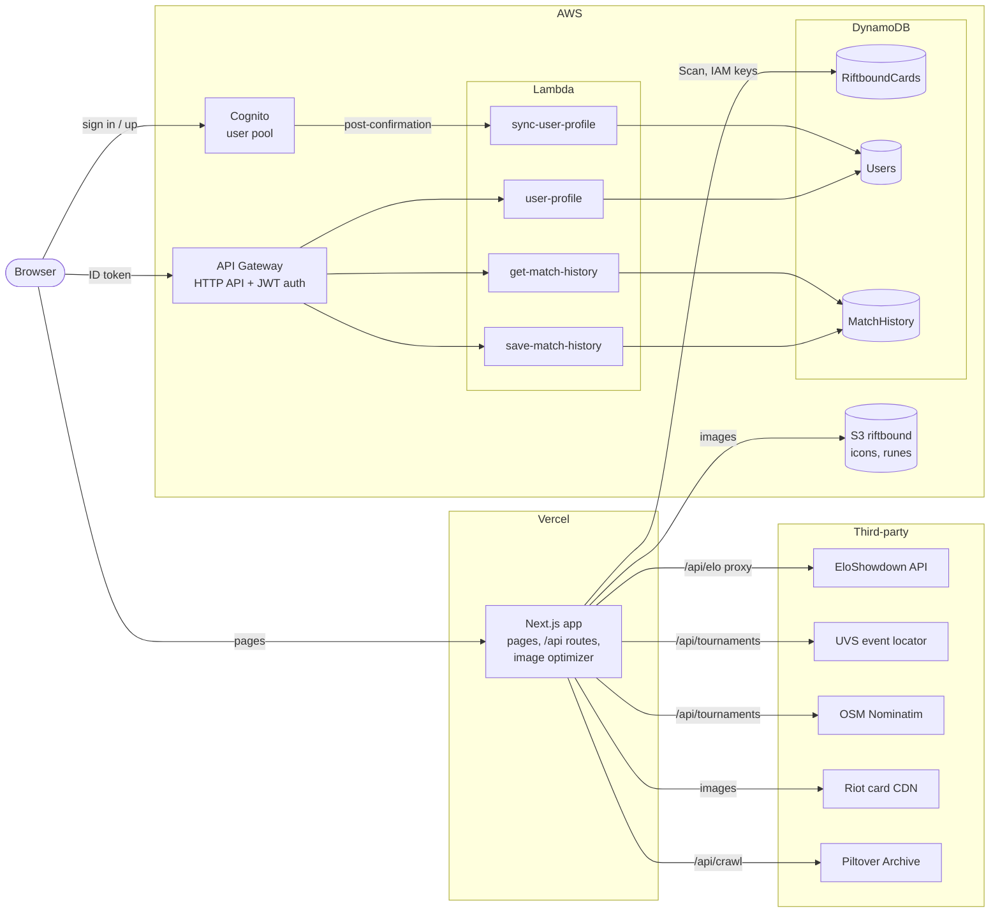
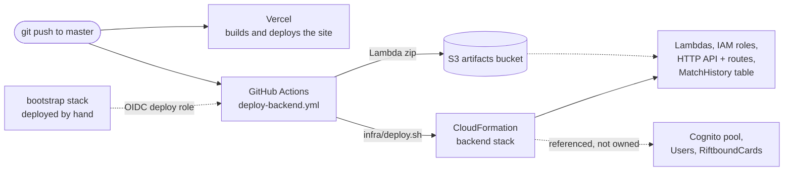

# Bilgewater Tracker

A fan-made companion for the Riftbound TCG — match history, Elo, card database and decks — built with Next.js 16 (App Router).

**Live:** [riftbound-gallery.vercel.app](https://riftbound-gallery.vercel.app/)

## Project Structure

```txt
riftbound/
├── content/
│   ├── news/                  # News posts (Markdown + frontmatter)
│   └── dev-log/               # Dev log entries, shown at /devlog
├── lambda/                    # One .mjs per Lambda — see Architecture
│   ├── getMatchHistory.mjs    # GET /history
│   ├── saveMatchHistory.mjs   # POST /history
│   ├── userProfile.mjs        # GET/PUT /profile
│   └── syncUserProfile.mjs    # Cognito post-confirmation trigger
├── infra/                     # CloudFormation stacks + deploy script (infra/README.md)
├── .github/workflows/         # deploy-backend.yml — backend deploy on push to master
└── src/
    ├── app/                   # App Router pages (server components) and /api routes
    │   ├── layout.js          # Root layout: Navbar, theme script, global styles
    │   ├── page.js            # / — profile, match history and stats
    │   ├── cards/             # /cards — card search
    │   ├── decks/             # /decks — community deck lists
    │   ├── news/              # /news and /news/[slug]
    │   ├── devlog/            # /devlog and /devlog/[slug]
    │   ├── login/, signup/    # Cognito sign in / sign up
    │   └── api/               # tournaments (UVS lookup), crawl (deck sites)
    ├── components/            # Client UI, by area
    │   ├── Navbar.js          # Nav, auth menu, light/dark toggle
    │   ├── auth/              # Sign-in / sign-up forms
    │   ├── cards/             # Card grid, filters, modal, deck builder, rune icons
    │   ├── decks/             # Deck sources and filters
    │   └── user/              # Profile, match rows + legend picker, Data tab, stats
    ├── hooks/                 # useAuth (Cognito session), useTheme
    └── lib/                   # Pure utilities — no React
        ├── data.js            # Design tokens: THEMES, COLORS, FONT_MONO
        ├── api.js             # Fetch wrappers for API Gateway
        ├── db.js              # DynamoDB client (server only)
        ├── cards/             # Card queries, card/rune/legend config, text parser
        ├── matchStats.js      # Record, streaks, Elo, matchup stats
        ├── eloshowdown.js     # EloShowdown API client
        ├── uvs.js, geocode.js # Tournament lookup helpers
        └── posts.js           # Markdown reader for news and dev log
```

## Getting Started

### 1. Install dependencies

```bash
npm install
```

### 2. Run development server

```bash
npm run dev
```

Open [http://localhost:3000](http://localhost:3000).

### 3. Build for production

```bash
npm run build
npm start
```

---

## Adding News Posts

Create a new `.md` file in `content/news/`. Frontmatter fields:

```markdown
---
title: "Your Post Title"
date: "2026-03-28"
author: "Author Name"
category: "Set Release"        # Set Release | Meta Report | Announcement | Dev Diary | Tournament
excerpt: "Short description shown on the index page."
---

Your post content in **Markdown** here.
```

---

## Architecture

The site runs on **Vercel**. Everything user-specific — accounts, linked
EloShowdown profiles, saved match history — lives in **AWS** behind an
authenticated API. Third-party data (EloShowdown, UVS, deck sites) is only
ever fetched by the site's own server routes, never by the browser directly.

### Runtime



There are two ways into AWS, and the split is deliberate:

- **Public card data** — the Next.js server reads the whole `RiftboundCards`
  table (one Scan per page load, filtered client-side) with an IAM access key
  set as `RIFTBOUND_AWS_*` in Vercel. No user is involved, so there's no token.
- **User data** — always goes browser → API Gateway with the user's Cognito ID
  token. A JWT authorizer verifies it, and each Lambda takes the user id from
  the token's `sub` claim, never from the request.

**Cognito.** The browser signs in and signs up directly against the user pool
(`amazon-cognito-identity-js`), so passwords never pass through Vercel. When a
sign-up is confirmed, the pool's post-confirmation trigger runs
`sync-user-profile`, which creates the user's `Users` row.

**API routes** (all require the ID token):

| Route | Lambda | Table | Does |
|---|---|---|---|
| `GET /profile` | `user-profile` | `Users` | Read linked EloShowdown accounts |
| `PUT /profile` | `user-profile` | `Users` | Add, select or remove a linked account |
| `GET /history` | `get-match-history` | `MatchHistory` | One account's saved matches, paginated |
| `POST /history` | `save-match-history` | `MatchHistory` | Upsert matches with legend picks |

**Tables** (on-demand, standard class, no GSIs):

| Table | Key | Holds |
|---|---|---|
| `RiftboundCards` | — | Every card; read by the Next.js server. Name set by `DYNAMODB_TABLE_CARDS` |
| `Users` | `userId` | Profile, linked EloShowdown accounts, the active one |
| `MatchHistory` | `userId` + `accountMatchId` (`<eloPlayerId>#<matchId>`) | Each match's EloShowdown data (result, opponent, Elo before / change / after, season) plus the user's legend picks |

**S3.** The public `riftbound` bucket (in `us-east-1`; everything else is in
`ap-southeast-2`) holds champion icons, rune icons and type icons. They're
served through the Next.js image optimizer, like the card art from Riot's CDN.

**Third-party services**, all called server-side:

| Service | Called from | For |
|---|---|---|
| [EloShowdown](https://eloshowdown.com/riftbound/) | `/api/elo/*` (a rewrite in `next.config.js`), `/api/tournaments` | Player search and Elo history |
| UVS event locator | `/api/tournaments` (`src/lib/uvs.js`) | Which tournament a match was played in |
| OpenStreetMap Nominatim | `/api/tournaments` (`src/lib/geocode.js`) | Locating a player's community to find nearby events |
| Riot card CDN | Image optimizer | Card art |
| Piltover Archive | `/api/crawl` | Community deck lists for the Decks page |

### Deploys



- **Frontend:** Vercel builds and deploys on every push to `master` (and
  preview deploys for other branches). Its environment variables are set in the
  Vercel project settings — see `CLAUDE.md` → Environment Variables.
- **Backend:** `.github/workflows/deploy-backend.yml` runs on every push to
  `master` (or by hand from the Actions tab). It assumes the deploy role through
  GitHub's OIDC — no stored AWS keys — and runs `infra/deploy.sh`, which zips
  `lambda/` into the artifacts bucket and deploys `infra/backend.yml`.
- **Owned vs referenced:** the backend stack creates the Lambdas, their roles,
  the API and `MatchHistory`. The Cognito pool, `Users` and `RiftboundCards`
  hold real data that predates the stack, so it only references them — they
  are never created or replaced by a deploy.
- **The bootstrap stack** (`infra/bootstrap.yml`: the deploy role and the
  artifacts bucket) is deployed by hand, once.

Setup, adding a Lambda, and debugging a failed deploy: see
[`infra/README.md`](infra/README.md).

---

## Pages

| Route | Description |
|---|---|
| `/` | Profile: linked EloShowdown accounts, stats, match history with legend picks (sign-in required) |
| `/cards` | Card search with filters, card details and deck builder |
| `/decks` | Community deck lists from Piltover Archive and other sources |
| `/news`, `/news/[slug]` | News index and posts |
| `/devlog`, `/devlog/[slug]` | Development log |
| `/about` | Why the site is called Bilgewater Tracker, plus Riot Games and EloShowdown credits |
| `/login`, `/signup` | Cognito sign in and sign up |
| `/user` | Redirects to `/` (old profile URL) |

## Credits

- Match history and tournament data provided by [EloShowdown](https://eloshowdown.com/riftbound/) via their public API
- Card data sourced from the [Riftbound Card Gallery](https://riftbound.leagueoflegends.com/en-us/card-gallery/)
- Riftbound is a trading card game developed by [Riot Games](https://www.riotgames.com) and published by [UVS Games](https://www.uvsgames.com)
